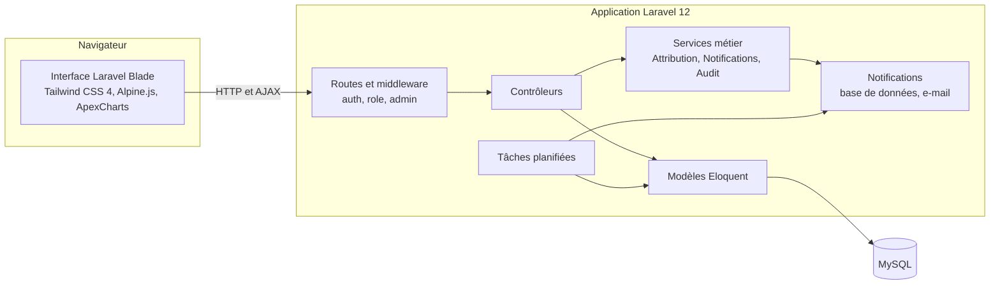

# Étude de cas — CRM Laravel

**Un CRM pour piloter ventes, clients et support, avec un espace dédié à chaque rôle.**

Laravel 12 · PHP 8 · MySQL · Blade · Tailwind CSS 4 · Alpine.js · Pest

[Démonstration visuelle](https://cedrickemmanuel25.github.io/CRM/) ·
[Code source](https://github.com/cedrickemmanuel25/CRM)

---

## En bref

Application web de gestion de la relation client qui réunit la base de contacts, le pipeline des
ventes, l'attribution des affaires aux commerciaux, les tâches, le support par tickets, le reporting
et l'administration. Quatre profils — administrateur, commercial, support, visiteur — y travaillent
avec des droits distincts, appliqués côté serveur et vérifiés par des tests automatisés.

| | |
|---|---|
| **Rôle** | Conception et développement complets (back-end, interfaces, base de données, tests, déploiement) |
| **Type** | Application web métier, monolithe Laravel en rendu serveur |
| **Périmètre** | 10 modules, 4 rôles, 38 migrations, 100 routes |
| **Qualité** | 53 tests automatisés (179 assertions), recette navigateur desktop et mobile |

## 1. Problématique

Une équipe commerciale qui suit ses prospects dans des tableurs et ses demandes clients par e-mail
perd la visibilité sur trois questions simples : *où en est chaque affaire ?*, *qui s'en occupe ?*,
*que faut-il faire aujourd'hui ?* Les relances sont oubliées, les responsabilités floues, et l'activité
est difficile à mesurer.

Il fallait un outil unique, utilisable par des profils aux besoins différents :

- **l'administrateur** pilote l'activité, gère les comptes et la configuration ;
- **le commercial** suit ses prospects et ses affaires, sans voir celles de ses collègues ;
- **l'agent support** traite les demandes des clients ;
- **le visiteur** consulte l'activité en lecture seule.

L'application devait aussi pouvoir être déployée sur un hébergement mutualisé (cPanel), sans accès
SSH garanti.

## 2. Objectifs

1. Donner une vision instantanée du pipeline : affaires et montants par étape, valeur pondérée,
   taux de conversion.
2. Rendre le cycle de vente explicite : chaque passage d'étape demande les informations utiles.
3. Répartir les affaires entre commerciaux de façon traçable, manuellement ou par règles.
4. Ne laisser aucune action en suspens : rappels des tâches du jour et en retard.
5. Offrir au support un suivi des tickets relié aux fiches clients.
6. Garantir la traçabilité : journal d'audit, historiques, exports journalisés.

## 3. Architecture

Une application Laravel unique, rendue côté serveur avec Blade, plutôt qu'un front-end séparé : un
seul déploiement sur hébergement mutualisé, une seule base de code, et la sécurité native de Laravel
(sessions, CSRF, validation). L'interactivité est apportée par Alpine.js ; les graphiques par
ApexCharts.

Choix structurants :

- **Contrôle d'accès en deux niveaux** : middleware par groupe de routes (`role:admin,commercial`,
  `admin`…), puis vérification d'appartenance dans les contrôleurs.
- **Activités et tâches polymorphes**, rattachables à un contact, une opportunité ou un ticket, avec un
  `morphMap` qui découple la base des noms de classes PHP.
- **Historiques dédiés** : `opportunity_histories` (stades), `opportunity_attribution_histories`
  (attributions), `audit_logs` alimenté par des observateurs Eloquent.
- **Événements et subscribers** : les actions métier déclenchent des notifications envoyées selon les
  préférences globales et personnelles de chaque utilisateur.

## 4. Technologies

| Couche | Technologie |
|---|---|
| Back-end | PHP 8.2+ (validé en 8.4), Laravel 12.44 |
| Base de données | MySQL / MariaDB (validé en MariaDB 10.4) |
| Interface | Blade, Tailwind CSS 4.1, Alpine.js 3, ApexCharts |
| Build | Vite 7.3 |
| Documents | DomPDF 3.1 (exports PDF) |
| Tests | Pest 4.3 (PHPUnit 12.5), Playwright pour la recette navigateur |

## 5. Fonctionnalités

- **Tableaux de bord par rôle** : vue globale (leads, CA prévisionnel, actions en attente, répartition
  par stade), vue commerciale (CA prévisionnel, conversion, quota, retards), console support.
- **Contacts** : recherche, filtres, fiche à onglets, notes, activités, tâches et tickets liés, export,
  conversion en opportunité.
- **Pipeline** : Kanban et liste, transitions d'étape par modales, historique des stades.
- **Attribution** : manuelle ou par règles priorisées, avec historique.
- **Tâches et agenda** : Kanban, vue semaine, rappels.
- **Support** : tickets catégorisés et priorisés, réponses, rapports PDF.
- **Reporting** : exports CSV et PDF filtrables et journalisés.
- **Administration** : utilisateurs, demandes d'accès, paramètres, règles, audit, sauvegarde, export RGPD.

## 6. Règles métier

Règles implémentées dans le code et vérifiées pendant la recette :

| Domaine | Règle |
|---|---|
| Accès | Un commercial ne voit et ne modifie que ses contacts (propriétaire) et ses opportunités (commercial assigné) ; il n'accède qu'aux tickets qu'il a créés ou qui concernent ses contacts. Le visiteur est en lecture seule. |
| Connexion | Au-delà de 5 tentatives échouées en une minute pour une même IP, la connexion est temporairement bloquée. |
| Pipeline | Six étapes : prospection, qualification, proposition, négociation, gagné, perdu. Chaque changement d'étape est historisé et journalisé. |
| Statut du contact | Il suit automatiquement l'opportunité la plus avancée du contact : une affaire gagnée en fait un client, une affaire en négociation le place en négociation. |
| Indicateurs | Valeur pondérée = montant × probabilité ; taux de conversion = affaires gagnées / (gagnées + perdues). |
| Attribution | Seul l'administrateur choisit le commercial ou l'attribution automatique ; une opportunité créée par un commercial lui est affectée. En automatique, les règles actives sont évaluées par priorité décroissante et la première qui correspond s'applique ; sans règle applicable, l'affaire revient au commercial ayant le moins d'opportunités actives. |
| Création d'opportunité | La date de clôture prévue doit être postérieure à la date du jour. |
| Contacts | Un e-mail de contact est unique. |
| Tâches | Une tâche est en retard si son échéance est passée et qu'elle n'est pas terminée ; rappels et alertes sont envoyés chaque jour à 9 h. |
| Comptes | Une demande d'accès publique crée un compte uniquement après approbation par un administrateur. |
| Traçabilité | Chaque export CSV / PDF et chaque action sensible sur les comptes est inscrit au journal d'audit. |

## 7. Parcours utilisateurs

**Commercial — faire avancer une affaire.** Il se connecte et arrive sur son tableau de bord, qui
affiche ses retards et ses rendez-vous. Dans le pipeline, il fait passer une opportunité de
« qualification » à « proposition » : une modale lui demande le besoin et le budget. L'étape, les
données et l'historique sont enregistrés, et la fiche du contact passe automatiquement au statut
« proposition ».

**Administrateur — répartir et superviser.** Il crée une opportunité en choisissant l'attribution
automatique : la règle « montant supérieur à 50 000 € » l'affecte à la commerciale concernée, qui
reçoit une notification. Il valide une demande d'accès, consulte le journal d'audit et exporte les
opportunités du trimestre en PDF.

**Agent support — traiter une demande.** Depuis sa console, il crée un ticket lié à un client, le
priorise, répond puis le passe en « résolu ». L'historique des réponses reste attaché au ticket, que
l'on retrouve dans la liste par une recherche sur le nom du client ou de son entreprise.

## 8. Défis techniques et solutions

| Défi | Solution |
|---|---|
| **Cloisonner les données sans dupliquer les écrans** : les mêmes vues servent quatre rôles. | Requêtes filtrées selon le rôle et contrôles d'appartenance sur chaque action. Une recette par rôle a révélé des actions encore ouvertes (changement de stade par le visiteur, modification de tickets par un commercial non concerné) : elles ont été fermées et sont couvertes par des tests. |
| **Relations polymorphes et `morphMap`** : les activités créées depuis une fiche étaient enregistrées avec le nom de classe complet et n'apparaissaient pas sur la fiche. | Normalisation du type reçu avec `Relation::getMorphAlias()` et liste blanche des types acceptés, ce qui empêche aussi de rattacher une activité à un modèle arbitraire. |
| **Composants Alpine.js et structure HTML** : après un refactoring, des balises orphelines fermaient le composant du pipeline trop tôt ; les modales de transition perdaient leur état. | Diagnostic sur le DOM réellement construit par le navigateur (Playwright, JavaScript désactivé), plus fiable que le comptage des balises dans des templates Blade conditionnels ; balises retirées et URL cible rétablie. |
| **Montée de version de Carbon 3** : `diffInDays()` renvoie une valeur signée et décimale, d'où des durées « -4 jours ». | Ordre des opérandes inversé, résultat converti en entier, test dédié. |
| **Encodage des noms accentués** : `substr()` coupait les caractères UTF-8 (« Élise »), ce qui cassait le JSON du sélecteur de contacts. | Passage à `mb_substr` / `mb_strtoupper` sur l'ensemble des initiales. |
| **Déploiement sans Node.js ni SSH** | Assets Vite compilés et versionnés, procédure cPanel documentée ; retrait des scripts de diagnostic qui restaient accessibles publiquement. |

## 9. Résultats vérifiables

- **53 tests automatisés, 179 assertions**, tous réussis sur MySQL : authentification, permissions,
  parcours métier et ouverture de chaque écran pour chaque rôle.
- Rejoués sur le code antérieur aux corrections, **13 tests échouaient** : ils couvrent bien les
  anomalies traitées.
- **Recette navigateur** de 50 écrans en desktop (1440 × 1024) et mobile (390 × 844) : 0 erreur
  JavaScript, 0 requête en échec, 0 débordement horizontal.
- **0 vulnérabilité npm** après suppression de deux dépendances inutilisées.
- Journal détaillé des problèmes, causes, corrections et validations :
  [WORK_LOG.md](https://github.com/cedrickemmanuel25/CRM/blob/main/docs/WORK_LOG.md).

## 10. Captures

| Écran | Capture |
|---|---|
| **Pipeline commercial** — colonnes par étape avec nombre d'affaires et montants ; chaque carte indique le commercial et la probabilité. |  |
| **Fiche contact** — statut synchronisé avec les opportunités, coordonnées, responsable, onglets et note interne. |  |
| **Tableau de bord commercial** — CA prévisionnel, conversion, quota mensuel, retards et rendez-vous. |  |
| **Console support** — tickets par statut et par priorité, file d'attente et urgences. |  |
| **Agenda** — vue semaine combinant tâches et activités planifiées. |  |
| **Administration** — comptes, rôles, coordonnées et date d'adhésion. |  |

Toutes les captures proviennent de l'application en fonctionnement, sur un jeu de données entièrement
fictif. La galerie complète (21 écrans, desktop et mobile) est consultable dans la
[démonstration visuelle](https://cedrickemmanuel25.github.io/CRM/).

## 11. Limites et pistes d'évolution

- Remplacer la réinitialisation des mots de passe à une valeur fixe par un lien envoyé par e-mail.
- Restreindre les rôles proposés dans la demande d'accès publique.
- Rendre le quota commercial paramétrable (fixé aujourd'hui à 50 000 € dans le code).
- Centraliser les autorisations dans des *Policies* Laravel.
- Embarquer Alpine.js et ApexCharts dans le build Vite plutôt que de les charger par CDN.
