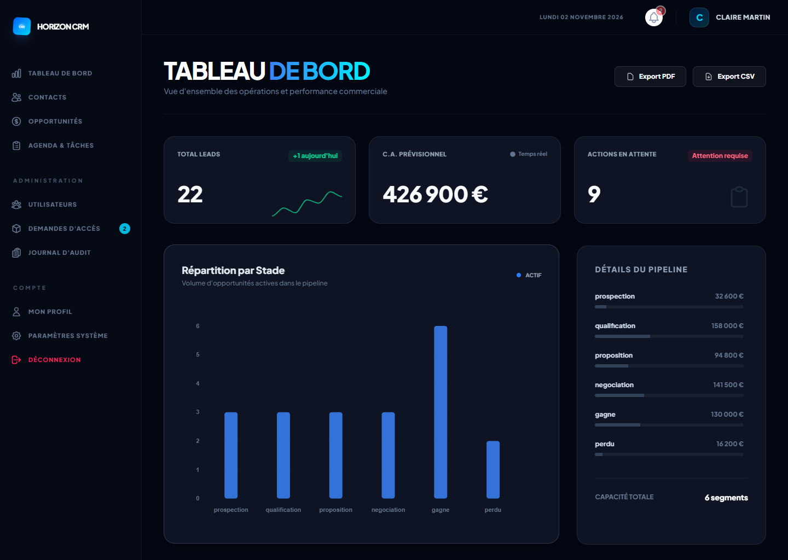
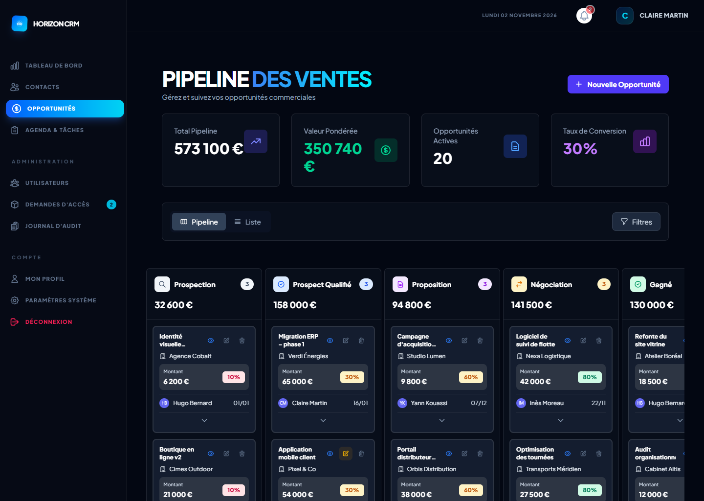
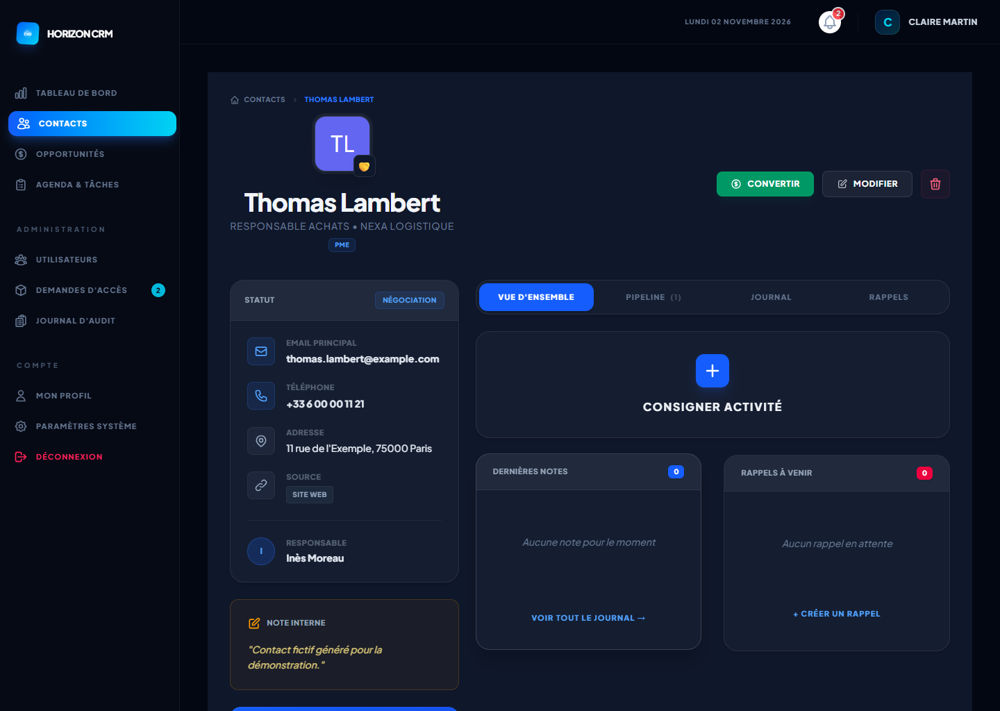
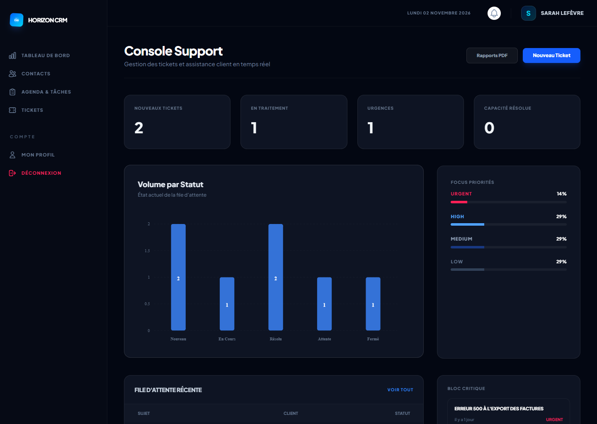
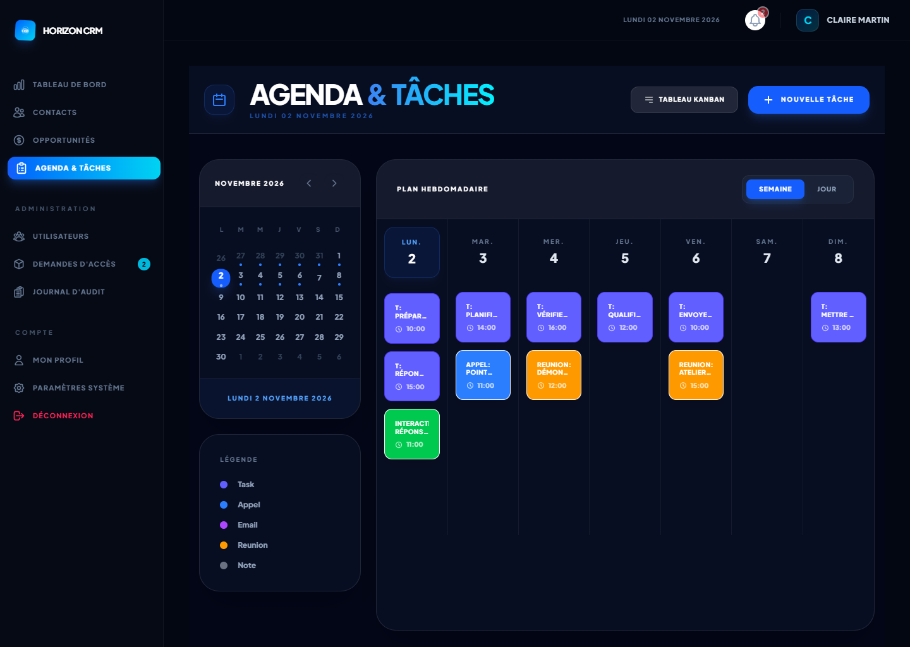

# Étude de cas — CRM Laravel

> Application de gestion de la relation client : contacts, pipeline commercial, attribution des
> affaires, tâches, support et pilotage. Laravel 12 · MySQL · Blade · Tailwind CSS 4 · Alpine.js.

## 1. Contexte

Le projet est né d'un besoin d'entreprise : remplacer un suivi commercial dispersé (tableurs, e-mails,
notes personnelles) par un outil unique, utilisable par des profils différents. L'application a été
conçue pour un usage réel puis déployée sur un hébergement mutualisé administré par cPanel, sans accès
SSH garanti — une contrainte qui a influencé plusieurs choix techniques (assets compilés versionnés,
procédures de maintenance documentées).

Quatre profils devaient travailler dans le même outil, avec des besoins et des droits distincts :

- **l'administrateur** pilote l'activité, gère les comptes et la configuration ;
- **le commercial** suit ses prospects et ses affaires, sans voir celles de ses collègues ;
- **l'agent support** traite les demandes des clients ;
- **le visiteur** consulte l'activité en lecture seule.

## 2. Objectifs

1. Donner une vision instantanée du pipeline : nombre d'affaires et montants par étape, valeur
   pondérée par la probabilité, taux de conversion.
2. Rendre le cycle de vente explicite : chaque passage d'étape demande les informations utiles
   (besoin et budget en qualification, montant proposé et document en proposition, motif en cas de
   perte).
3. Répartir les affaires entre commerciaux de façon traçable, manuellement ou par règles.
4. Ne laisser aucune action en suspens : rappels des tâches du jour et en retard dès la connexion.
5. Offrir au support un suivi des tickets par statut et priorité, relié aux fiches clients.
6. Garantir la traçabilité : journal d'audit, historique des stades et des attributions, exports
   journalisés.

## 3. Choix d'architecture

### Monolithe Laravel en rendu serveur

Une application Laravel unique, rendue côté serveur avec Blade, plutôt qu'un front-end séparé :
déploiement simple sur un hébergement mutualisé, une seule base de code, une sécurité gérée par les
mécanismes natifs de Laravel (sessions, CSRF, validation). L'interactivité (Kanban, modales de
transition, filtres, rafraîchissement AJAX) est apportée par **Alpine.js**, les graphiques par
**ApexCharts**.

### Contrôle d'accès en deux niveaux

1. **Middleware** sur les groupes de routes : `role:admin,commercial`, `role:support`, `admin`…
2. **Vérification d'appartenance** dans les contrôleurs : un commercial obtient une erreur 403 sur un
   contact, une opportunité ou un ticket qui ne le concerne pas.

Ce découpage garde les routes lisibles tout en couvrant les cas que le rôle seul ne suffit pas à
trancher.

### Modèle de données

- `contacts` → `opportunities` (1-n), chaque opportunité ayant un commercial responsable ;
- `activities` et `tasks` **polymorphes** : rattachables à un contact, une opportunité ou un ticket,
  avec un `morphMap` (`contact`, `opportunity`, `ticket`) pour découpler la base des noms de classes ;
- `opportunity_histories` et `opportunity_attribution_histories` pour l'historique des stades et des
  attributions ;
- `audit_logs` alimenté par des **observateurs** Eloquent ;
- `settings` et `notification_preferences` pour la configuration (nom de l'organisation, devise,
  préférences globales et personnelles de notification).

### Moteur d'attribution

`AttributionService` applique des règles ordonnées par priorité — source du contact, montant
supérieur à un seuil, secteur, ou équilibrage de charge vers le commercial ayant le moins d'affaires
en cours. Chaque attribution, manuelle ou automatique, est historisée avec sa raison
(« Règle : Grands comptes (> 50 000 €) »).

### Événements et notifications

Les actions métier déclenchent des événements (`OpportunityWon`, `TaskCreated`…) traités par des
subscribers, qui passent par `NotificationService` : ce service détermine les destinataires
(propriétaire, commercial, assigné, ou administrateurs pour les événements de supervision) et les
canaux (base de données, e-mail) selon les préférences de chacun.

### Synchronisation contact ↔ opportunités

`OpportunityObserver` recalcule le statut d'un contact à partir de l'opportunité la plus avancée
(une affaire gagnée en fait un client). La fiche contact reflète ainsi toujours l'état réel du
pipeline sans saisie en double.

## 4. Fonctionnalités principales

| Pipeline commercial | Fiche contact |
|---|---|
|  |  |

- **Pipeline** en Kanban et en liste, indicateurs (total, valeur pondérée, conversion), transitions
  d'étape par modales dédiées, historique des stades.
- **Contacts** avec recherche, filtres, fiche à onglets (activités, opportunités, rappels, notes),
  export et conversion en opportunité.
- **Agenda et tâches** : Kanban des tâches et vue semaine combinant tâches et activités.
- **Support** : console dédiée, tickets catégorisés et priorisés, réponses, rapports PDF par période.
- **Rapports** : exports CSV et PDF filtrables, page imprimable, chaque export étant journalisé.
- **Administration** : utilisateurs, validation des demandes d'accès, règles d'attribution, journal
  d'audit, sauvegarde et export RGPD.
- **Tâches planifiées** : sauvegarde quotidienne de la base, rappels et alertes de retard, synthèse de
  performance.

| Console support | Agenda |
|---|---|
|  |  |

## 5. Défis techniques

### Cloisonner les données sans complexifier les écrans

Les mêmes écrans servent quatre rôles. La solution retenue combine des requêtes filtrées selon le rôle
(un commercial ne voit que ses contacts dans la liste, ses opportunités dans le pipeline, ses données
dans les exports) et des contrôles d'appartenance sur chaque action. Lors de la finalisation, une
recette par rôle a révélé des actions encore ouvertes à des profils qui ne devaient pas y accéder
(changement de stade par le visiteur, modification de tickets par un commercial non concerné) ; elles
ont été corrigées et sont désormais couvertes par des tests automatisés.

### Relations polymorphes et `morphMap`

Déclarer un `morphMap` rend la base indépendante des noms de classes PHP, mais impose que toutes les
écritures utilisent les alias. Les formulaires envoyaient encore le nom de classe complet : les
activités et tâches créées depuis une fiche étaient enregistrées mais n'y apparaissaient pas. La
correction normalise le type reçu avec `Relation::getMorphAlias()` et restreint les types acceptés à
une liste blanche, ce qui ferme au passage la possibilité de rattacher une activité à un modèle
arbitraire.

### Interfaces Alpine.js et structure HTML

Les modales de transition du pipeline vivent dans le composant Alpine de la page. Un refactoring de
mise en page avait laissé des balises fermantes orphelines : le navigateur fermait le composant trop
tôt, les modales perdaient l'accès à leur état et le formulaire n'avait plus d'URL cible. Le
diagnostic a été fait en analysant le DOM réellement construit par le navigateur (Playwright, JavaScript
désactivé), plus fiable qu'un comptage des balises dans des templates contenant des conditions Blade.

### Montée de version de Carbon

Avec Carbon 3 (Laravel 11+), `diffInDays()` renvoie une valeur signée et décimale. Les durées
calculées dans le sens « maintenant → date passée » affichaient « -4 jours » dans le pipeline et des
retards négatifs dans les alertes. L'ordre des opérandes a été inversé et le résultat converti en
entier, avec un test dédié.

### Déploiement sur hébergement mutualisé

Sans Node.js sur le serveur, les assets Vite compilés sont versionnés dans `public/build`. La
finalisation a aussi permis de retirer les scripts de diagnostic ajoutés pendant la mise en
production : utiles pour déboguer sans SSH, ils restaient accessibles publiquement.

## 6. Qualité et résultats vérifiés

- **53 tests automatisés** (Pest, 179 assertions) sur MySQL : authentification, permissions par rôle,
  parcours métier (contacts, transitions de stade, tickets, demandes d'accès, exports), et chargement
  de chaque écran principal pour chaque rôle à partir du jeu de démonstration.
- Les tests de non-régression ont été rejoués sur le code antérieur aux corrections : 13 échecs,
  confirmant qu'ils détectent les anomalies traitées.
- **Recette navigateur** avec Playwright en desktop (1440 × 1024) et mobile (390 × 844) : aucune
  erreur JavaScript ni débordement horizontal sur les écrans audités.
- `npm audit` : 0 vulnérabilité après suppression de deux dépendances inutilisées.
- Journal complet des problèmes, causes, corrections et validations : [`WORK_LOG.md`](WORK_LOG.md).

## 7. Limites et pistes d'évolution

- Remplacer la réinitialisation des mots de passe à une valeur fixe par un lien de réinitialisation
  envoyé par e-mail, et ne plus afficher les mots de passe temporaires.
- Restreindre les rôles proposés dans la demande d'accès publique.
- Rendre le quota commercial paramétrable (il est aujourd'hui fixé dans le code).
- Formaliser les autorisations dans des *Policies* Laravel pour centraliser les règles d'accès.
- Embarquer Alpine.js et ApexCharts dans le build Vite plutôt que de les charger par CDN.

Les autres limites connues sont listées dans le [README](../README.md#sécurité-et-limites-connues).
