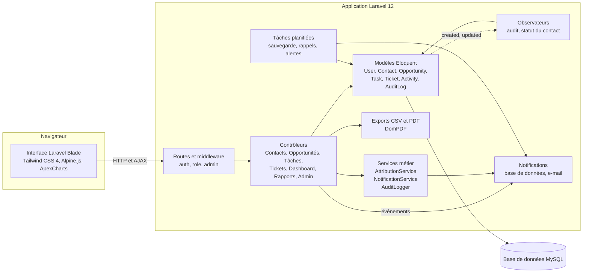

# Architecture

## Vue d'ensemble

Application Laravel monolithique en rendu serveur. Les vues Blade sont enrichies par Alpine.js et
ApexCharts ; la logique métier est répartie entre contrôleurs, services, modèles Eloquent,
observateurs et événements.

## Couches

| Couche | Rôle |
|---|---|
| Routes et middleware | Groupes de routes protégés par `auth`, `role:…` (CheckRole) et `admin` (AdminOnly). |
| Contrôleurs | Un contrôleur par module ; vérification d'appartenance (contact, opportunité, ticket) avant chaque action d'un commercial. |
| Services | `AttributionService` (règles et équilibrage de charge), `NotificationService` (destinataires et canaux selon les préférences), `AuditLogger`. |
| Modèles et observateurs | Eloquent, scopes métier (`inProgress`, `won`, `byCommercial`…), observateurs qui journalisent et synchronisent le statut des contacts. |
| Événements | `ContactCreated`, `OpportunityWon`, `TaskCreated`… traités par des subscribers qui produisent les notifications. |
| Planificateur | Sauvegarde quotidienne (2 h), rappels et alertes de tâches (9 h). |

## Modèle de données

| Table | Contenu |
|---|---|
| `users` | Comptes et rôle (`admin`, `commercial`, `support`, `visitor`) |
| `contacts` | Contacts, propriétaire, source, statut pipeline, tags |
| `opportunities` | Affaires : contact, commercial, montant, stade, probabilité, données de qualification et de négociation |
| `opportunity_histories` | Historique des changements de stade |
| `opportunity_attribution_histories` | Historique des attributions et leur motif |
| `attribution_rules` | Règles d'attribution automatique priorisées |
| `activities` | Appels, e-mails, réunions, notes — polymorphes (contact, opportunité, ticket) |
| `tasks` | Tâches assignées, polymorphes (contact, opportunité) |
| `tickets` | Tickets de support : catégorie, priorité, statut, assignation, pièce jointe |
| `notifications`, `notification_preferences` | Notifications en base et préférences par événement |
| `access_requests` | Demandes d'accès publiques |
| `audit_logs` | Journal d'audit (anciennes et nouvelles valeurs, IP, agent) |
| `settings` | Paramètres de l'organisation (nom, devise…) |

## Choix techniques

- **Monolithe en rendu serveur** : un seul déploiement sur hébergement mutualisé et la sécurité native
  de Laravel (sessions, CSRF, validation), sans API séparée à maintenir.
- **Contrôle d'accès en deux niveaux** (middleware + appartenance), couvert par des tests.
- **`morphMap`** pour découpler la base des noms de classes ; les types reçus sont normalisés et
  limités à une liste blanche.
- **Assets compilés versionnés** pour déployer sans Node.js.
