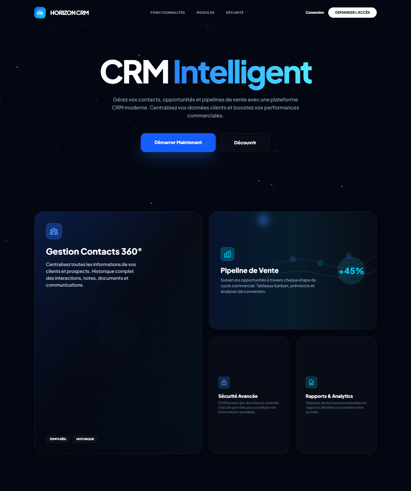

# CRM Laravel — Présentation du projet

## Titre

**CRM Laravel — Gestion commerciale, support client et pilotage**

## Description courte

Application web de gestion de la relation client développée avec Laravel 12 : contacts, pipeline des
ventes, attribution des affaires, tâches, support par tickets, reporting et administration, avec un
espace dédié à chaque rôle.

*Version en une phrase (cartes de portfolio) :* un CRM Laravel qui centralise contacts, pipeline
commercial et support, avec des droits par rôle vérifiés par 53 tests automatisés.

## Problématique

Une équipe commerciale qui suit ses prospects dans des tableurs et ses demandes clients par e-mail
perd la visibilité sur l'état des affaires, sur les responsabilités de chacun et sur les actions à
mener. Les relances sont oubliées et l'activité est difficile à mesurer.

## Objectifs

1. Une vision instantanée du pipeline : montants par étape, valeur pondérée, conversion.
2. Un cycle de vente explicite, avec les informations à saisir à chaque transition.
3. Une répartition traçable des affaires entre commerciaux, manuelle ou par règles.
4. Des rappels pour ne laisser aucune tâche en retard.
5. Un suivi du support relié aux clients.
6. Une traçabilité complète : audit, historiques, exports journalisés.

## Chiffres vérifiés

| Indicateur | Valeur |
|---|---|
| Modules métier | 10 |
| Rôles | 4 (administrateur, commercial, support, visiteur) |
| Migrations | 38 |
| Tests automatisés | 53 tests, 179 assertions, tous réussis |
| Recette navigateur | 50 écrans × 2 formats, 0 erreur JavaScript |
| Captures réelles | 21 (desktop et mobile) |

## Liens

- Démonstration visuelle : https://cedrickemmanuel25.github.io/CRM/
- Code source : https://github.com/cedrickemmanuel25/CRM
- Étude de cas complète : [CASE_STUDY.md](CASE_STUDY.md)

## Contenu de ce dossier

| Fichier | Contenu |
|---|---|
| [CASE_STUDY.md](CASE_STUDY.md) | Étude de cas éditoriale complète |
| [TECH_STACK.md](TECH_STACK.md) | Technologies et versions vérifiées |
| [FEATURES.md](FEATURES.md) | Fonctionnalités, règles métier et parcours utilisateurs |
| [ARCHITECTURE.md](ARCHITECTURE.md) | Architecture, modèle de données, choix techniques |
| [SCREENSHOTS.md](SCREENSHOTS.md) | Captures légendées |
| `screenshots/` | 21 captures PNG réelles |
