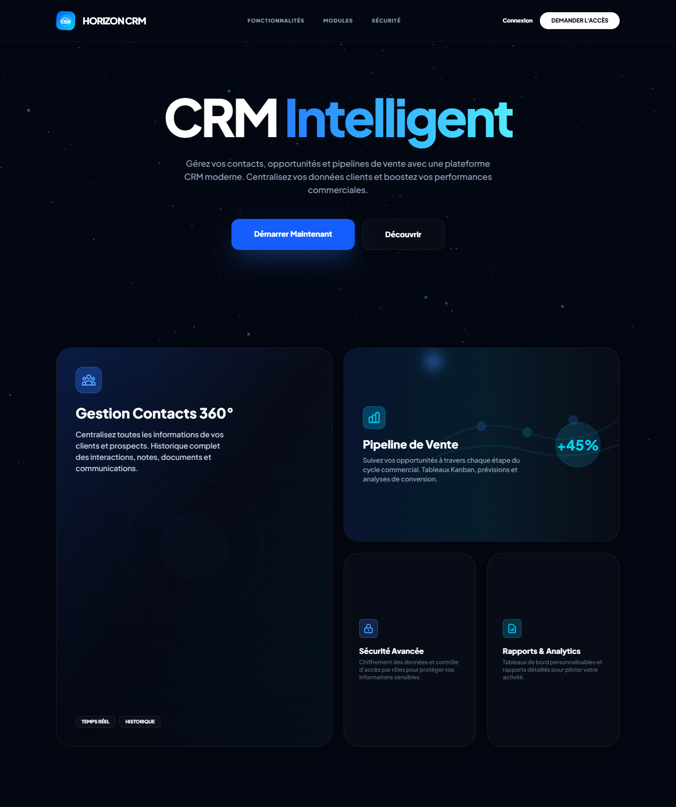
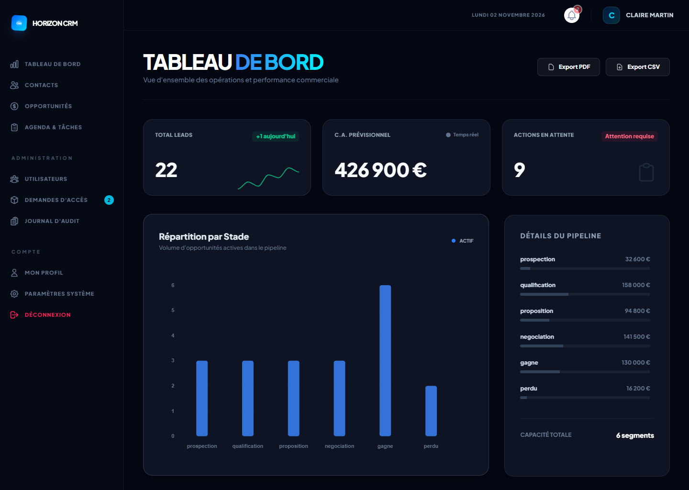
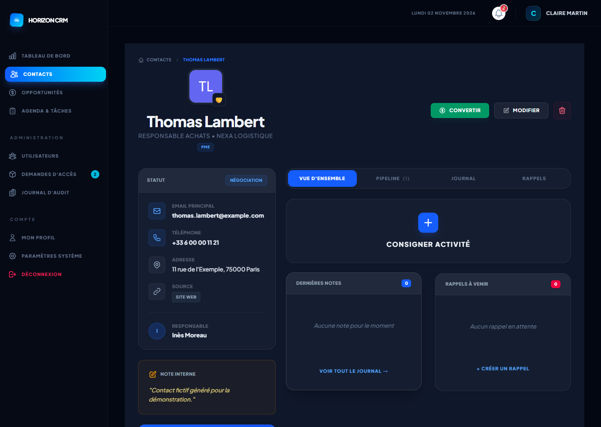
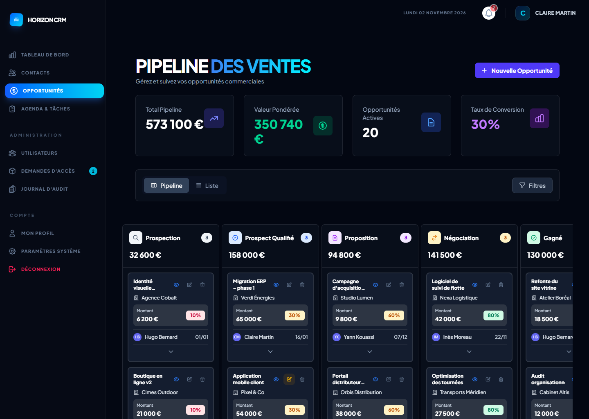
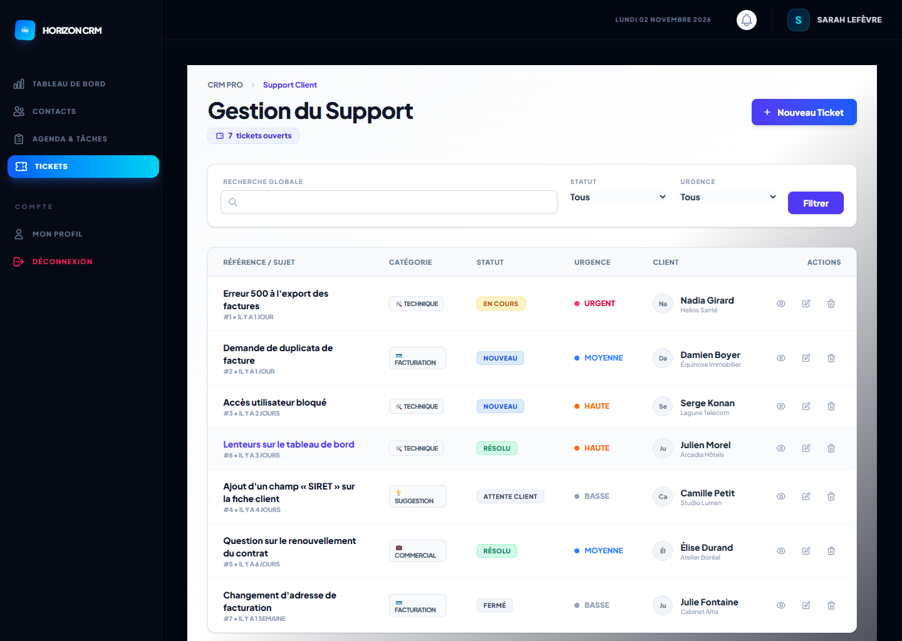

# Captures

Captures réelles de l'application en fonctionnement, réalisées avec Playwright (Chromium) sur une base
de démonstration aux données entièrement fictives. Formats : desktop 1440 × 1024, mobile 390 × 844 ;
les deux captures de la page d'accueil couvrent la page entière.

## Accueil et authentification

| Fichier | Légende |
|---|---|
| `screenshots/landing-desktop.png` (1440 × 1718) | Page d'accueil publique, capture intégrale : navigation, présentation, cartes des modules. |
| `screenshots/landing-mobile.png` (390 × 2256) | Page d'accueil sur mobile, capture intégrale. |
| `screenshots/login.png` | Connexion : e-mail, mot de passe, « rester connecté », lien vers la demande d'accès. |
| `screenshots/mobile-login.png` | Connexion sur mobile. |

## Tableaux de bord

| Fichier | Légende |
|---|---|
| `screenshots/dashboard-admin.png` | Administrateur : leads, CA prévisionnel, actions en attente, répartition des opportunités par stade. |
| `screenshots/dashboard-commercial.png` | Commercial : CA prévisionnel, conversion, quota mensuel, retards, rappels, rendez-vous. |
| `screenshots/mobile-dashboard-commercial.png` | Tableau de bord commercial sur mobile. |
| `screenshots/support-dashboard.png` | Console support : tickets par statut et priorité, file d'attente, urgences. |

## Contacts

| Fichier | Légende |
|---|---|
| `screenshots/contacts.png` | Liste des contacts : recherche, filtres, statut CRM, propriétaire. |
| `screenshots/contact-detail.png` | Fiche contact : statut synchronisé, coordonnées, onglets, note interne. |
| `screenshots/mobile-contacts.png` | Liste des contacts sur mobile, en cartes. |

## Pipeline et opportunités

| Fichier | Légende |
|---|---|
| `screenshots/pipeline.png` | Pipeline Kanban : affaires et montants par étape, commercial et probabilité. |
| `screenshots/mobile-pipeline.png` | Indicateurs du pipeline sur mobile. |
| `screenshots/opportunities-list.png` | Liste des opportunités : montant pondéré, stade, échéance, commercial. |
| `screenshots/opportunity-detail.png` | Fiche opportunité : montant, probabilité, contact, interactions. |

## Tâches, support, reporting, administration

| Fichier | Légende |
|---|---|
| `screenshots/tasks.png` | Tâches en Kanban : à faire, en cours, terminées. |
| `screenshots/calendar.png` | Agenda hebdomadaire des tâches et activités. |
| `screenshots/tickets.png` | Liste des tickets : catégorie, statut, urgence, client. |
| `screenshots/reports.png` | Centre d'exports CSV et PDF. |
| `screenshots/admin-users.png` | Gestion des utilisateurs et des rôles. |
| `screenshots/admin-settings.png` | Paramètres de l'organisation. |

